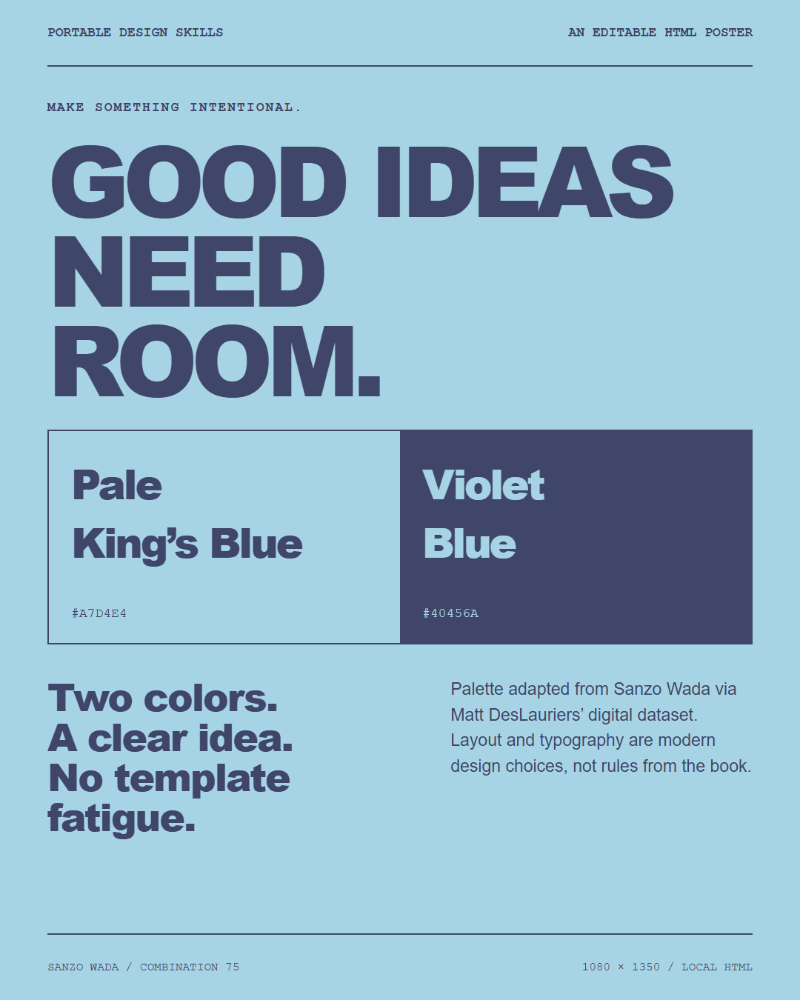

# Portable Design Skills

**Source-backed colors. Intentional layouts. Real HTML and PNG artifacts.**

A small, model-independent skill pack for AI assistants that design websites and posters. It packages the Sanzo Wada color workflow, an adaptable design process, and practical HTML-to-PNG rendering in the open [Agent Skills](https://agentskills.io/specification) format.

No API key, paid AI provider, Claude Design account, or hosted image service is required by the included tools. The AI assistant itself is your choice.



## What's included

| Skill | What it supplies |
| --- | --- |
| [`sanzo-wada-design`](skills/sanzo-wada-design/SKILL.md) | 159 colors and 348 combinations, offline lookup/filtering, palette gallery, and pairwise contrast checks. |
| [`artifact-design`](skills/artifact-design/SKILL.md) | Composition-first design, typography, responsive behavior, image handling, source honesty, and visual review. |
| [`html-poster-design`](skills/html-poster-design/SKILL.md) | Editable HTML posters, Russian/Hebrew/RTL guidance, a generic template, and a working PNG export CLI. |

These are procedures, not a single fixed aesthetic. Pink, burgundy, blue, or restrained editorial layouts are choices driven by the brief—not a requirement to imitate any AI vendor's branding.

## Use it with an AI assistant

```sh
git clone https://github.com/necromancer124/portable-design-skills.git
cd portable-design-skills
```

Then ask your file-capable assistant:

> Read AGENTS.md and the three skills in skills/. Use the Sanzo Wada skill to show me three real palette directions, recommend one, and build a complete responsive website. Label any added neutrals and check text contrast.

Or:

> Use combination 75 to make a 1080 × 1350 poster. Keep my supplied image uncropped. Make separate Russian and Hebrew versions, export PNGs, and inspect the renders. Do not publish my photos.

**Native installation:** copy the skill folders into your client's supported skill directory. Claude Code uses `.claude/skills/`; Codex uses `.agents/skills/`; Hermes supports profile-local and trusted project skills. Exact instructions and official links are in [compatibility.md](docs/compatibility.md).

**Other assistants:** give them `AGENTS.md` and the relevant `SKILL.md` plus its assets/references/scripts. A chat-only model can read the instructions, but cannot execute lookup or render files without suitable tools. Instruction-format compatibility does not guarantee native discovery or identical design output.

## Try the palette tools — standard library only

Requires Python 3.10 or later. On systems where the executable is `python3`, substitute that for `python`.

```sh
python skills/sanzo-wada-design/scripts/palettes.py --id 75
python skills/sanzo-wada-design/scripts/palettes.py --search pink --size 2 --min-contrast 4.5 --limit 6
python skills/sanzo-wada-design/scripts/palettes.py --contrast '#a7d4e4' '#40456a'
python skills/sanzo-wada-design/scripts/palettes.py --gallery output/wada-palettes.html
python skills/sanzo-wada-design/scripts/palettes.py --self-test
```

`--min-contrast` means **at least one color pair qualifies**, not that every pair is safe for body text. Contrast checks operate on opaque six-digit sRGB HEX colors; they are not a full accessibility audit.

## Export the example poster

Rendering is optional. Install its dependency and browser explicitly:

```sh
python -m pip install -r requirements-render.txt
python -m playwright install chromium
python skills/html-poster-design/scripts/render.py skills/html-poster-design/assets/poster.html --output output/poster.png --selector .poster --width 1080 --height 1350 --scale 2
```

This creates a **2160 × 2700 PNG** from a real 1080 × 1350 HTML canvas. A generic Hebrew/RTL template is also included at [`poster-he.html`](skills/html-poster-design/assets/poster-he.html), with a [rendered preview](docs/poster-he-preview.png). To use an existing browser instead, add `--browser msedge` or `--browser chrome`.

The renderer blocks remote HTTP(S) assets unless `--allow-network` is explicitly supplied. Use embedded or local assets for offline artifacts. **Render trusted HTML only:** network blocking is not a security sandbox.

## Check the package

```sh
python -m pip install -r requirements-dev.txt
python -m playwright install chromium
python -m unittest discover -s tests -v
```

The tests include a real browser PNG export, source-data checks, portable skill metadata, filtering/error handling, and privacy/path scans. Browser tests are explicitly skipped if Playwright is missing and fail with instructions if a requested browser is unavailable. [Verification details and limits](docs/verification.md).

## Source and licensing boundaries

- Palette relationships come from a **community digital transcription** of Sanzo Wada's *A Dictionary of Color Combinations*, published by Seigensha. This is **not a scan or the full book**.
- Digital RGB/HEX values approximate printed swatches. Modern layouts, typography, component roles, and accessible pair selection are adaptations, not historical claims about Wada's prose.
- Palette data: Matt DesLauriers, derived from Dain M. Blodorn Kim; MIT license retained.
- The artifact-design workflow adapts BadTechBandit's MIT-declared `claude-design` guide. It is **not affiliated with Anthropic or the hosted Claude Design product**.
- This public repo intentionally contains **no personal photos, private posters, chat transcripts, or credentials**. The preview is a new generic example.

See [LICENSE](LICENSE), [THIRD_PARTY_NOTICES.md](THIRD_PARTY_NOTICES.md), and the bundled [dataset license](skills/sanzo-wada-design/references/DATA-LICENSE.md).
