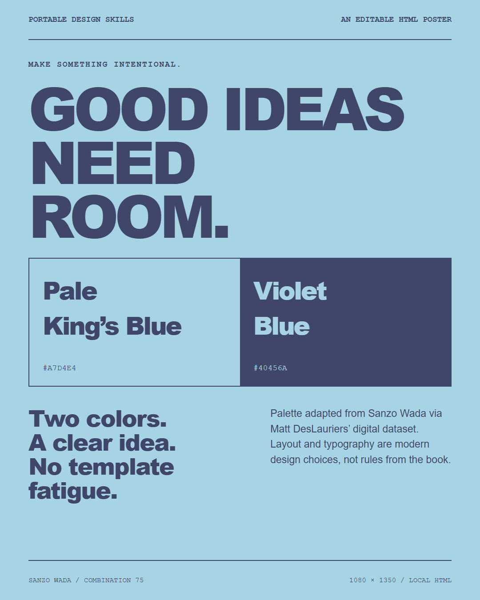

# portable-design-skills

**Source-backed colors. Intentional layouts. Real HTML and PNG artifacts.**

Three design skills that Claude uses on its own when you ask for a poster, flyer, website, landing page, dashboard or color palette, or simply ask it to make something look good.



## Install

```
/plugin install portable-design-skills --marketplace necromancer124/portable-design-skills
```

Then start a new session. The skills load as `portable-design-skills:sanzo-wada-design`, `portable-design-skills:artifact-design` and `portable-design-skills:html-poster-design`.

## What's included
- **sanzo-wada-design:** 159 colors and 348 real combinations from a digital transcription of Sanzo Wada's *A Dictionary of Color Combinations*, with offline lookup, filtering, a palette gallery and text-contrast checks.
- **artifact-design:** a composition-first design workflow: choosing a layout that fits the task, typography, color roles, responsive behavior, honest content and a visual review of the render.
- **html-poster-design:** editable HTML posters at exact sizes, uncropped images, separate language versions and high-resolution PNG export.

These are procedures, not one fixed look. The colors and layout come from your brief.

## What you need
- Python 3.10 or later for the palette helper (standard library only).
- For PNG export only: Playwright for Python with its Chromium browser, or an installed Chrome or Edge. See the official guide at https://playwright.dev/python/docs/intro.

Nothing is installed automatically.

## What the plugin runs, sends and fetches
- **Runs, only when a skill is used:** `skills/sanzo-wada-design/scripts/palettes.py` to look up palettes, check contrast and write a local HTML gallery. For PNG export, `skills/html-poster-design/scripts/render.py` starts a headless Chromium, Chrome or Edge through Playwright to screenshot a local HTML file.
- **Sends:** nothing. There are no hooks, no MCP servers, no telemetry and no API keys.
- **Fetches:** nothing. The palette data is bundled, and the renderer blocks remote requests unless you pass `--allow-network`. The generated gallery contains source links that only open if you click them.

## Sources and licenses
- Palette data: Matt DesLauriers' MIT-licensed digital dataset, derived from Dain M. Blodorn Kim's transcription. It's not a scan or the full book. See `skills/sanzo-wada-design/references/DATA-LICENSE.md`.
- The artifact-design workflow adapts BadTechBandit's MIT-declared `claude-design` guide. It isn't affiliated with Anthropic or the hosted Claude Design product. See `THIRD_PARTY_NOTICES.md` and `licenses/`.

More details, tests and other assistants: https://github.com/necromancer124/portable-design-skills

MIT licensed. See `LICENSE`.
